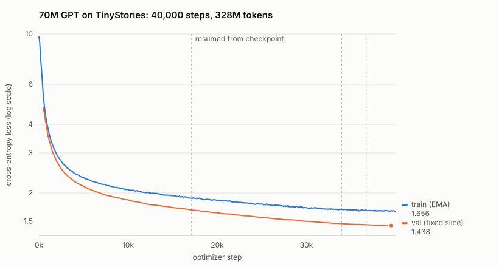
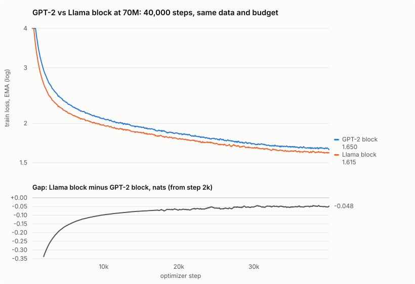

# Training GPTs from scratch in C++ on a laptop, and beating PyTorch on its own GPU

grad.cpp is a GPT training stack written from the ground up in C++20: tensors, reverse-mode automatic differentiation with a hand-derived backward pass for every op, multi-head attention, AdamW, a byte-level BPE tokenizer, a memory-mapped data pipeline, and a Metal backend for Apple GPUs. There are no ML frameworks underneath. The only external dependency is a BLAS library.

This post covers what I trained with it and what I measured:

- three ~70M-parameter language models trained from scratch on one MacBook (an M3 Pro): two on the CPU at 35 to 37 hours each, and one on the GPU in 12
- a controlled architecture A/B between them: the GPT-2 block against the Llama-style block
- the validation number I almost published, and why it was wrong
- making training bit-for-bit reproducible, and why that mattered for everything after it
- a GPU execution mode that trains **1.56× faster than PyTorch's MPS backend** at 22M parameters, and 7 to 25% faster at 70M
- the bug a 12-hour soak test was designed to catch, and caught: a GPU `tanh` that returns NaN

Everything is at [github.com/liamford1/grad.cpp](https://github.com/liamford1/grad.cpp), and all three trained models can be downloaded from its releases.

## What it produces

A sample from the current flagship, a 69M-parameter model trained on the GPU with a lossless tokenizer. It is prompted with the bold text, sampled at temperature 0.8, first draw, unedited. The paragraph breaks are the model's own:

> **Once upon a time, there was a little dragon who** lived in the woods. He liked to explore and play with his friends all day long! One day, he got very sick and his mom took him to see the doctor. The doctor said that he needed medicine for one of her teeth but it was hidden down in a special place under the trees.
>
> The little dragon was scared, so with a deep breath, he went and found an old man who knew how to heal his tooth. The hero helped him get rid of the medicine from his teeth and gave it to him as a special treat for being brave.

The models are trained on [TinyStories](https://huggingface.co/datasets/roneneldan/TinyStories), a corpus of short children's stories designed so that small models can learn fluent English. It is a good fit for a laptop: a 70M model gets far enough to be interesting in half a day on the GPU.

## The stack

Every forward and backward pass is readable C++. The autograd graph is a DAG of `Variable` nodes, each holding a closure that propagates its gradient. `backward()` sorts the graph topologically and walks it in reverse, and frees each node's tensors the moment its gradient has been passed on. That last detail cut peak memory at 70M from 5.7GB to 4.1GB. Every op's gradient is checked against central-difference numerical gradients in the test suite, from single ops up to the whole model.

Profiling drove most of the performance work, and [BENCHMARKS.md](../BENCHMARKS.md) records every round, including the ones that did nothing:

- **Batching:** feeding proper `(batch, seq)` inputs fixed a bug where tokens attended across sequence boundaries.
- **BLAS backward passes:** rewriting them as single matrix-multiply calls, with no materialized transposes.
- **Vectorized math:** the elementwise math goes through Apple's vectorized libraries.
- **Thread pool:** a persistent pool, with attention parallelized per (batch, head).
- **KV cache:** generation reuses the attention keys and values it has already computed.
- **Overhead round:** a profile of live training found that dropout random-number generation, memory copies and zero-filling ate about a third of the CPU time.

Together those took the 22M benchmark from 1.2 to 8 optimizer steps per second.

## Training a 70M model on a laptop

The `medium` preset is a GPT-2-style decoder: d768, 8 layers, 12 heads, a 16,000-token vocabulary, 256-token context, and an effective batch of 32 sequences via gradient accumulation. It trained for 40,000 steps (328M tokens), about 37 hours.

Long runs on a machine you also use need to survive interruption. The trainer handles Ctrl-C by saving a resume pair (weights, both Adam moments, the schedule position) at the next step boundary. Both files are written to temporary names first and then renamed, so a crash mid-save can't corrupt them. A small supervisor script restarts the trainer after crashes and resumes from the saved state. The run was paused three times to free the machine, and the loss curve shows no seam at any of them.

## The number I almost published

During training, the trainer reported validation loss every 500 steps, and it ended at **1.438 (perplexity 4.21)**. That was the number I was about to put in the README.

While writing the run report, I added a `grad eval` command that scores a checkpoint on a uniform random sample of the held-out split. It said **1.693 (perplexity 5.44)**.

The in-loop evaluation always scored the first 65,536 tokens of the held-out split. That keeps the curve comparable with itself, which is useful while tracking a run. But those first few hundred stories after the split point turned out to be 0.25 nats easier than the split as a whole, and a fixed prefix has no way to show that. The held-out loss on a representative sample is also only 0.025 above the training loss, which is what a run that saw each window about once should look like.

The report leads with 1.693 and explains the gap, and the trainer now scores windows spread evenly across the split. The general lesson: **a number is only as good as the sample behind it.** Checking that a measurement is consistent is not the same as checking that it is representative.

## An A/B: the GPT-2 block against the Llama block

The `modern` preset is the same model with the block most current LLMs use: RMSNorm instead of LayerNorm, rotary position embeddings instead of learned ones, and a bias-free SwiGLU feed-forward, sized so the parameter count is nearly equal (69.0M vs 69.8M). It trained on the same data, with the same tokenizer, optimizer, schedule, seed and 40,000-step budget. Only the block changed.

| | GPT-2 block | Llama block |
|---|---:|---:|
| held-out loss (same 1M tokens) | 1.693 | **1.647** |
| perplexity | 5.44 | **5.19** |
| parameters | 69.8M | 69.0M |

The Llama block led at every point. The gap was a third of a nat early in training and settled at about 0.05. It reached the GPT-2 model's final training loss at step 30,220, so at this scale the architecture change was worth about a quarter of the training budget.

To make sure the two rows are comparable, I re-scored the GPT-2 model with the current binary, which reproduced its original figure to four decimals. One seed per architecture is a real limitation, and the [report](runs/2026-09-tinystories-modern-ab/README.md) says so. The gap is consistent from step 1,000 to 40,000, and about 30 times the difference between the run's own best and final checkpoints.

## Making training bit-reproducible

Two identically seeded training runs were diverging in the sixth significant digit by step 8. The cause turned out to be LayerNorm's backward pass. Each thread accumulated partial sums for the gamma and beta gradients, then added them into the result under a lock, in whatever order the threads happened to finish. Floating-point addition is not associative, so `(a + b) + c` and `a + (b + c)` can differ in the last bit, and that difference propagated through everything downstream.

The fix keeps one partial sum per fixed 16-row block and adds the blocks in order. Training is now bit-identical run to run *and* across thread counts: 1, 4 and 8 threads produce the same bytes. CI enforces it with a test that trains a small model on 1 thread and on 4, and fails unless the two sets of weights hash identically.

That property turned out to be the most useful thing in the project. It made every later refactor checkable. I moved the code to C++20, split the command-line front end into per-command files, replaced the 2D/3D tensor special cases with a general shape type, introduced a namespace, and fixed 552 `-Wconversion` warnings. After every commit, four reference checks (a determinism probe, a seeded training trace, greedy generation from the 70M checkpoint, and `grad eval`) had to reproduce exactly. A refactor that changes a result by a single bit fails loudly. Without that net, "cleanup" on numerical code is guesswork.

## Performance: what PyTorch does better, and then beating it

Measured against PyTorch 2.14 on the same machine, with identical model configs, fp32, and an idle-machine protocol:

| training config | grad.cpp (CPU) | PyTorch (CPU) | PyTorch (MPS GPU) |
|---|---:|---:|---:|
| 22M | 6,560 tok/s | 4,370 | 9,464 |
| 70M | 2,542 | 2,458 | 6,794 |

Two scale effects show here:

- **On CPU, grad.cpp's 1.5× lead at 22M is parity at 70M.** At 22M, per-op overhead is a large share of each step, and a specialized engine avoids it. At 70M the step is dominated by large matrix multiplies, and both engines hand those to the same Apple BLAS library.
- **On the GPU, PyTorch's lead grew with scale, to 2.7×.** grad.cpp only sent matrix multiplies above about 10 GFLOP to the GPU, and waited for each one to finish. PyTorch keeps the whole step on the device.

So I built a device-resident execution mode. Apple Silicon's CPU and GPU share memory, so the device is an *executor*, not a separate address space: tensors never move. In Metal mode, every op encodes a kernel into one command stream instead of running on the CPU, and the CPU waits only when it actually needs to read a result. In `grad train` that is once per optimizer step, and inside a benchmark trial it is never. Reads are safe by construction: a tensor that has been handed to the GPU makes its CPU accessors wait for queued work, and one that never has pays for a single byte load. The kernels cover everything a step needs:

- attention and the per-head matrix multiplies (the large GEMMs go through Apple's MPS)
- LayerNorm, RMSNorm, GELU, SwiGLU and RoPE
- a fused log-softmax plus cross-entropy
- embedding gradients and dropout
- AdamW and the gradient norm

The kernels avoid floating-point atomics, so GPU training is deterministic too. Dropout masks are bit-identical to the CPU's.

| training config | grad.cpp CPU | **grad.cpp Metal** | PyTorch MPS |
|---|---:|---:|---:|
| 22M | 6,380 tok/s | **14,760** | 9,464 |
| 70M GPT-2 block | 2,542 | **7,282** | 6,794 |
| 69M Llama block | 2,602 | **7,509** | 6,008 |

(The CPU column was re-measured in the same session as the Metal runs, which is why 22M reads 6,380 here and 6,560 in the table above. The two sessions are 3% apart.)

From the same seed at 70M, Metal and CPU training losses agree to all six significant digits the metrics log records. It trains the same model, not an approximation of it.

Two results from the same measurement pass are just as useful:

- **A null result.** Sweeping how many kernels go into each GPU submission, and how far the CPU may run ahead of the GPU, moved throughput by less than 3%. The GPU is compute-bound, and the defaults stay.
- **A cost.** Memory at 70M is a flat 5.1GB against the CPU mode's 1.3 to 3.1GB, because the buffer pool keeps its high-water mark.

I wrote down the expected results before measuring. 22M landed inside the predicted range, and 70M slightly above it.

## The bug the soak test caught

Before starting a 12-hour run in GPU mode, I ran a pre-flight: train the 22M preset on the GPU, interrupt it, resume it. It never got as far as the resume test. At exactly step 2,558 the loss became NaN, while the CPU run from the same seed kept going. Because the Metal path is deterministic, it happened at the same step every time. That turned an intermittent mystery into a two-minute reproduction.

A debug mode that synchronizes after every GPU op and checks its outputs found the first bad value. It was in GELU's forward pass, on an input of 10.4, finite, with a NaN output. GELU computes `tanh(k(x + a·x³))`, and at x = 10.4 that argument is 48.6.

The kernels were compiled with Metal's "safe" arithmetic mode. A separate setting picks which `tanh` implementation is used, and it defaults to the fast one. Measured on this GPU, fast `tanh` returns NaN for arguments above 44.4. The CPU's `tanh` saturates to 1 there. Step 2,558 was simply the first time any GELU input in the run grew past 10.

The fix is one line: precise math functions, at no measurable speed cost. It came with a regression test covering saturated inputs, and a soak script that trains any preset on both devices from one seed and compares them.

The lesson is about test design, not GPUs. Every parity test had passed, because tiny models trained for 8 steps never produce large activations. The failure was in the tail of a distribution that only a long run reaches.

## The flagship: GPU training with a lossless tokenizer

With the fix in, the flagship ran overnight: the Llama block, tokenizer v2, 40,000 steps, entirely on the GPU. It took **12.1 hours at 1.08 s per step**, in one uninterrupted session with no non-finite values. The same model took 35 hours on the CPU.

Comparing it with the earlier models needs a tokenizer-independent measure, since per-token loss depends on what a token is. `grad eval` reports bits per byte:

| model | tokenizer | held-out bits/byte | training time |
|---|---|---:|---:|
| GPT-2 block | v1 (lossy) | 0.4852 | 37.1 h, CPU |
| Llama block | v1 (lossy) | **0.4720** | 35.0 h, CPU |
| Llama block | v2 (lossless) | 0.4777 | **12.1 h, GPU** |

The v2 model lands about 1% behind the v1 Llama model, and the comparison is tilted against it. v2 predicts all 14.8 million of the corpus's newlines, which v1 never has to (v1's figure still divides by those bytes). And v2's tokens hold less text, so at the same token budget it read 17% less. What you see in the samples is the payoff: paragraphs, dialogue on its own lines, and stories that end.

## Smaller things that make it hold up

- **A lossless tokenizer.** The original BPE split on whitespace, so newlines never reached the model. Tokenizer v2 is byte-level: `decode(encode(x)) == x` for any bytes. Its hand-written GPT-2 pre-tokenizer matches the reference regex on 5 million pieces of real text. It learns merges hundreds of times faster, and breaks ties deterministically so macOS and Linux produce the same vocabulary. Checkpoints record their tokenizer's fingerprint and refuse a mismatch.
- **Validated file formats.** Every read from a checkpoint, token file and tokenizer cache is checked, sizes are bounded, and corrupt files are rejected with a message naming the file and the field.
- **CI:**
  - macOS and Linux builds, with warnings as errors under a strict set
  - AddressSanitizer and UndefinedBehaviorSanitizer runs
  - pinned clang-format and clang-tidy
  - a consumer project built against the installed CMake package
  - the thread-count determinism test
- **Honest benchmarks.** Repeated trials, medians, JSON with build and system provenance, and runs gated on an idle machine. One set of measurements was contaminated by an unrelated test suite on the same machine; it was thrown out and redone. Early on, a 70M comparison was withdrawn when an audit found an inconsistent calculation, and it stays in the history as a correction. So does a logging bug: the gradient norm in the metrics log was summed in single precision and read 4 to 11% low. The run reports that quoted it now say so.

## What's next

- **A compute-optimal run.** The flagship is at 4.75 training tokens per parameter against the usual ~20. On the GPU that is now about two days, not a week.
- **Multiple seeds for the A/B,** so the architecture gap comes with error bars.
- **Per-kernel GPU profiling,** then a fused attention kernel and multi-tensor AdamW, which are the first optimization targets.
- **Inference work:** generation on the GPU, and int8 quantization.

The code, the benchmark records, the run reports with their complete per-step metrics, and both models are in the [repository](https://github.com/liamford1/grad.cpp).
